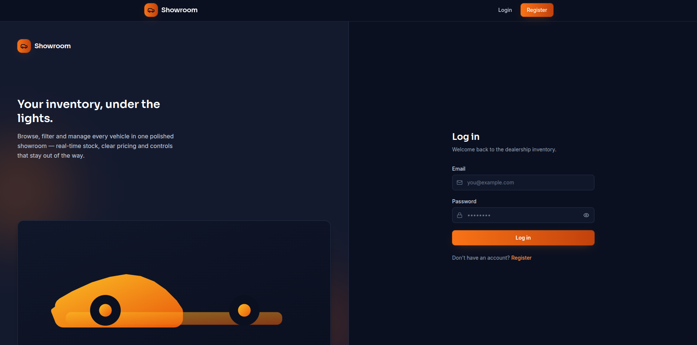
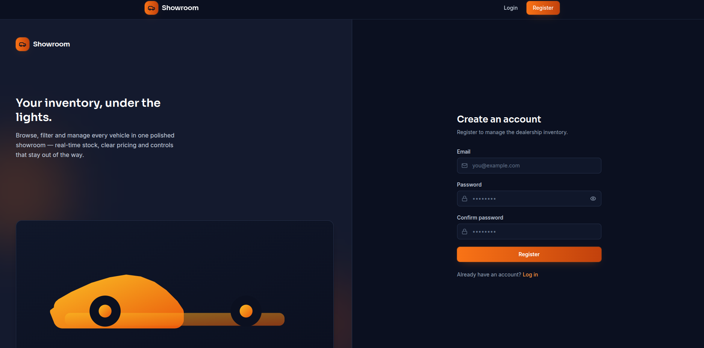
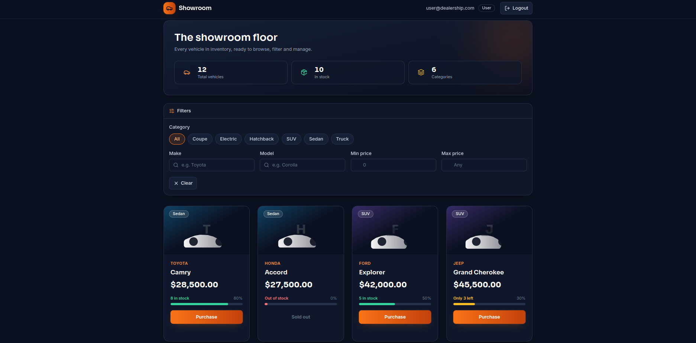
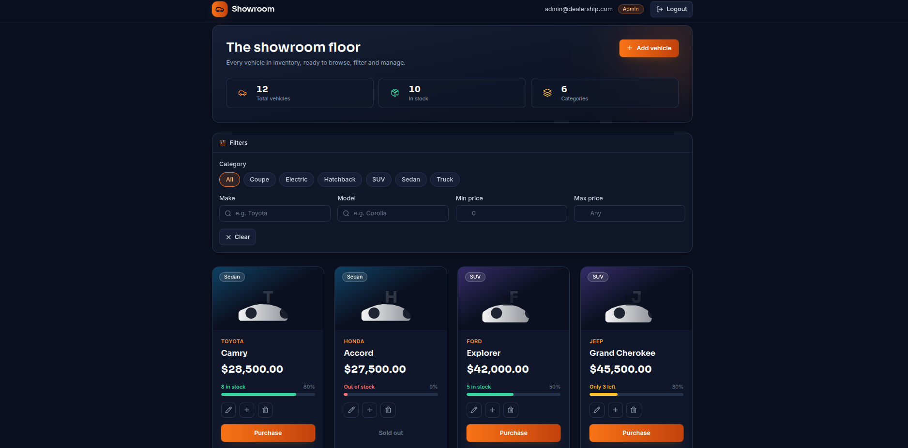
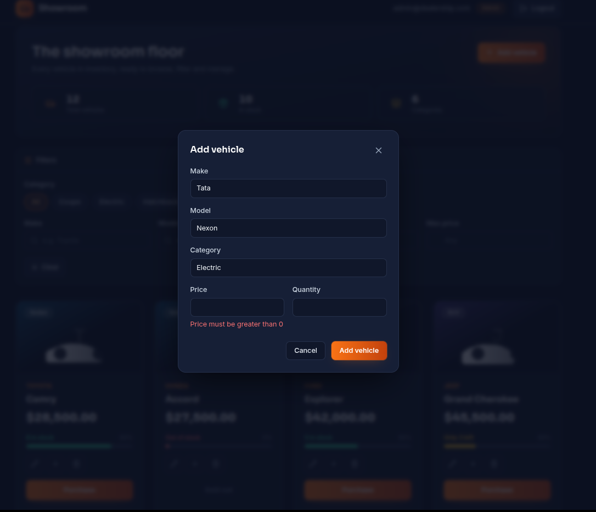
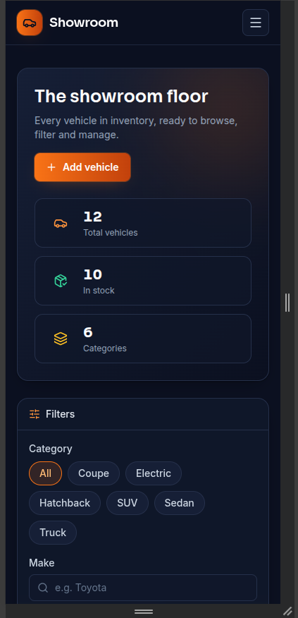

# Showroom: Car Dealership Inventory System

A full-stack car dealership inventory application built as a TDD take-home for Incubyte. Customers can browse, search and purchase vehicles. Admins can add, edit, restock and delete them. The backend was built strictly test-first, and the frontend was developed test-first within each feature.

- **Backend:** Node.js, TypeScript, Express 5, Prisma 6, SQLite, JWT auth
- **Frontend:** React 18, TypeScript, Vite, Tailwind CSS 3.4
- **Tests:** Jest and Supertest (backend, 83 tests), Vitest and React Testing Library (frontend, 91 tests)

> Deployed link: not deployed (optional bonus, skipped on purpose; see [Known limitations](#known-limitations)).

---

## Screenshots

| Login | Register |
|---|---|
|  |  |

| Dashboard (user) | Admin dashboard |
|---|---|
|  |  |

| Add vehicle (admin) | Mobile layout |
|---|---|
|  |  |


---

## Features

**Everyone (authenticated)**
- Register and log in (JWT, 1 day expiry by default)
- Browse all vehicles, including out-of-stock ones
- Search and filter by make, model (partial match), category and price range
- Purchase a vehicle, which decreases stock by one. The Purchase button is disabled when quantity is zero

**Admin only**
- Add, edit and delete vehicles
- Restock a vehicle (increase its quantity)
- Admin controls are hidden from regular users in the UI and enforced with `403` on the server

---

## Prerequisites

- Node.js 22 or newer (developed on v24) and npm
- Git

No Docker or external database server is needed. The database is a SQLite file created locally.

---

## Setup and run locally

### 1. Clone

```bash
git clone https://github.com/shherlocked/car-dealership-inventory.git
cd car-dealership-inventory
```

### 2. Backend (runs on http://localhost:4000)

```bash
cd backend
npm install
cp .env.example .env          # Windows: copy .env.example .env
# Edit .env and set your own JWT_SECRET
npx prisma generate
npm run migrate               # creates dev.db and applies migrations
npm run seed                  # creates admin, user and 12 sample vehicles
npm run dev
```

Leave this terminal running.

If `bcrypt` fails to load with a native module error, run `npm rebuild bcrypt`.

### 3. Frontend (runs on http://localhost:5173)

Open a second terminal:

```bash
cd frontend
npm install
npm run dev
```

The frontend calls `http://localhost:4000` by default. To change that, create `frontend/.env` with `VITE_API_URL=<backend url>` (see `frontend/.env.example`).

### 4. Demo accounts (created by the seed script, for local development only)

| Role | Email | Password |
|---|---|---|
| Admin | `admin@dealership.com` | `Admin@12345` |
| User | `user@dealership.com` | `User@12345` |

The seed script is idempotent, so it is safe to run more than once. Admin credentials can be overridden with `ADMIN_EMAIL` and `ADMIN_PASSWORD` in `backend/.env`. Registration always creates a regular `USER`, and a caller can never choose their own role.

---

## Running the tests

Backend (applies the test-database migrations automatically, then runs Jest with coverage):

```bash
cd backend
npm test
```

Frontend (from the repository root):

```bash
cd frontend
npm test
```

Other useful scripts: `npm run build` and `npm run lint` in both folders.

Backend test suites share one SQLite test database (`backend/prisma/test.db`), so Jest runs them serially (`maxWorkers: 1`). This was fixed after parallel runs caused flaky failures.

---

## Test report

Full terminal output is saved in:
- [`docs/backend-test-report.txt`](docs/backend-test-report.txt)
- [`docs/frontend-test-report.txt`](docs/frontend-test-report.txt)

| Suite | Result |
|---|---|
| Backend (Jest and Supertest) | 8 suites, **83 tests passed**; about 97% statements, 90% branches, 100% functions |
| Frontend (Vitest and React Testing Library) | 16 files, **91 tests passed** |
| Backend and frontend `build` and `lint` | Clean |

Backend coverage by area: controllers, routes, repositories and services are at or near 100%. The remaining uncovered lines are a few branches in the error handler and the `authenticate` middleware.

What the backend tests cover:
- **Unit:** auth service (hashing, JWT payload, generic errors), vehicle service (404, 409, 400 rules), `authenticate` and `requireRole` middleware (missing, malformed, invalid and expired tokens, role mismatch)
- **Integration (Supertest against a real SQLite test DB):** every endpoint and status code, permission checks for `USER` and `ADMIN`, search filters alone and combined, and that responses never contain password hashes
- **Concurrency:** two simultaneous purchases of the last unit result in exactly one `200` and one `409`, and final stock of `0`

---

## API reference

All routes except auth and health require `Authorization: Bearer <token>`. Errors always use the shape `{ "error": { "message": "..." } }`.

| Method | Path | Access | Description | Success |
|---|---|---|---|---|
| GET | `/api/health` | Public | Health check | 200 |
| POST | `/api/auth/register` | Public | Register (`email`, `password` of at least 8 characters). Role is always `USER` | 201 |
| POST | `/api/auth/login` | Public | Returns `{ token, user }` | 200 |
| POST | `/api/vehicles` | Admin | Add a vehicle | 201 |
| GET | `/api/vehicles` | Authenticated | List all vehicles, including quantity 0 | 200 |
| GET | `/api/vehicles/search` | Authenticated | Query: `make`, `model`, `category`, `minPrice`, `maxPrice` (all optional, combinable) | 200 |
| PUT | `/api/vehicles/:id` | Admin | Partial update | 200 |
| DELETE | `/api/vehicles/:id` | Admin | Delete a vehicle | 204 |
| POST | `/api/vehicles/:id/purchase` | Authenticated | Decrease stock by 1 | 200 |
| POST | `/api/vehicles/:id/restock` | Admin | Body `{ "quantity": <positive integer> }` | 200 |

A vehicle has: `id`, `make`, `model`, `category`, `price` (greater than 0), `quantity` (integer, 0 or more), `createdAt`, `updatedAt`.

Common errors: `400` validation failure (including `minPrice` greater than `maxPrice`), `401` missing or invalid token or bad credentials, `403` insufficient role, `404` vehicle not found, `409` duplicate email on register or out of stock on purchase.

---

## Architecture and design decisions

**Backend** follows a layered structure with constructor-based dependency injection: `routes -> controllers -> services -> repositories`. Controllers contain no business logic. Input is validated with Zod, and one central error handler formats all errors.

Notable decisions:
- **Atomic purchase.** Stock is decremented with a single conditional update (`quantity > 0` in the `WHERE` clause), never read-then-write, so two buyers cannot oversell the last unit. A dedicated concurrency test proves it.
- **Generic login errors.** Unknown email and wrong password return the same `401 Invalid credentials`, so accounts cannot be enumerated.
- **Role safety.** Registration cannot set a role, and passwords are hashed with bcrypt and never returned.
- **SQLite and case-insensitive search.** Prisma's `mode: 'insensitive'` is not supported on SQLite. Make and model use `contains`, which is case-insensitive for ASCII there, and category is filtered case-insensitively in memory.
- **Out-of-stock vehicles stay visible** in the list, so the UI can show them with a disabled Purchase button.
- **Separate test database** (`.env.test`), reset before every test.

**Frontend:** React Router with a `ProtectedRoute` (with an `adminOnly` option), an `AuthContext` that persists the session, a global 401 handler that logs the user out when a token expires, a `useVehicles` hook that ignores stale responses, accessible modals (focus trap, Escape to close, focus return), and a responsive dark theme with category illustrations.

### Project structure

```text
backend/
  prisma/            schema, migrations, seed script
  src/               routes, controllers, services, repositories,
                     middleware, utils, config, types
  tests/             unit, integration, helpers, setup
frontend/
  src/               api, components, context, hooks, pages, utils
docs/                screenshots and test reports
prompts-log/         raw Roo Code task logs (one file per task)
PROMPTS.md           all AI chat logs
.roo/ .rooignore     rules given to the AI coding assistant
```

---

## Git history and TDD

The commit history follows Red, Green for the backend features:

1. `test: add failing tests for auth (red)`, then `feat: implement user registration and login with JWT`
2. `test: add failing tests for vehicles and inventory (red)`, then `feat: implement vehicle management, search and inventory`

The tests were written first and committed while failing. The implementation followed in a separate commit. Because of the time limit, I folded refactoring into the green commits instead of making empty "refactor" commits. The frontend was built test-first inside each prompt (the AI was instructed to write failing tests, then implement), but each frontend feature is committed as one commit, so its red phase is visible in the AI logs rather than in the git history.

---

## My AI Usage

### Tools used

1. **Roo Code** (VS Code extension) as the coding agent, using **DeepSeek** models through an OpenAI-compatible gateway (AICredits): `deepseek-v4.1-flash` for the backend and seed script, and `deepseek-v4-pro` for the frontend scaffold, dashboard, admin UI and visual redesign.
2. **Claude** (Anthropic) as the planner and reviewer. It decided the tech stack and workflow, wrote every prompt I gave Roo Code, reviewed the test output I pasted back, and helped debug problems.

### How I used them

- **Workflow.** I used Claude as the "brain" and Roo Code as the "hands". For every backend feature the loop was: a prompt to write failing tests only, I ran them and committed (red); a prompt to implement the minimum code, I ran them and committed (green). Roo Code was told in `.roo/rules` never to commit. I made every commit myself so the history stays clean and the co-author trailer is correct.
- **Project rules for the AI.** `.roo/rules/rules.md` told the agent to follow strict TDD, a layered architecture with dependency injection, Zod validation and SOLID principles, and to avoid adding features beyond the current prompt.
- **What Roo Code generated:** the project scaffold, all tests, the implementation of every layer, the seed script, all frontend pages and components, and the visual redesign.
- **What Claude did:** chose the stack (for example SQLite with Prisma 6 and Tailwind 3.4 to avoid setup friction on a one-day deadline), designed the API behaviour (admin-only routes, atomic purchase, out-of-stock vehicles stay listed), wrote and corrected prompts, and diagnosed issues.
- **What I did myself:** ran every test, build and lint command myself (instead of trusting the AI's summaries), tested each feature in the browser as both admin and user, reviewed what would be committed, wrote all commits, and managed the repository.

### Reflection

AI made it realistic to build a tested full-stack application in about a day. Having an AI plan the work and a second AI execute it kept each prompt small and verifiable. Writing tests before implementation was easy to enforce because the agent was only allowed to do one half at a time.

It also needed supervision, and these are the cases where it did:
- **Parallel test flake.** Roo's own summary spotted that two auth tests failed under parallel Jest runs because all suites shared one SQLite file. I fixed it by running Jest serially.
- **A gap in my own prompt.** The login page worked but did not redirect to the dashboard, because the prompt I was given never specified it. I only found out by using the app in the browser, not from the passing tests. A follow-up prompt fixed it.
- **A dropped feature.** During the visual redesign the purchase success toast was lost, and I chose not to restore it. The card's stock count still updates and errors still show on the card.
- **Tooling problems.** Roo Code hung silently because it could not find `ripgrep` in a newer VS Code build, and I fixed it with a symlink.
- **Attribution.** My first co-author trailer used an email that GitHub matched to a real person's account, so I replaced it with a neutral address.

My main takeaways: green tests prove the code matches the tests, not that the product works, so I always checked in the browser too. Prompts need to state the behaviour completely, since the AI does exactly what is written. And the AI's summary is a claim to verify, not evidence.

AI chat logs are in [`PROMPTS.md`](PROMPTS.md) and in `prompts-log/`. The Roo Code task exports are raw and unedited. The planning chat with Claude (`00-planning-chat-claude.md`) is an excerpt: whole exchanges about API billing and model-provider setup are omitted and marked with `[omitted: ...]` lines, and nothing inside the remaining messages was edited. Every AI-assisted commit carries a `Co-authored-by` trailer.

---

## Known limitations

- **No deployment.** The database is a local SQLite file, and most free hosts reset their disks, so a hosted version would lose data. This was an optional bonus, and I spent the time on tests and documentation instead.
- **Admin accounts come from the seed script** only. There is deliberately no public way to become an admin.
- **No purchase success toast.** Stock updates on the card, but no notification appears (see reflection above).
- **No payment flow.** "Purchase" decreases stock only, as the brief describes.
- **`npm audit`** reports advisories in development dependencies. I did not run `npm audit fix --force`, because it can upgrade major versions and break the pinned toolchain.
- **Demo credentials** in this README are for local development only. Set your own `JWT_SECRET` and admin password for any real use.